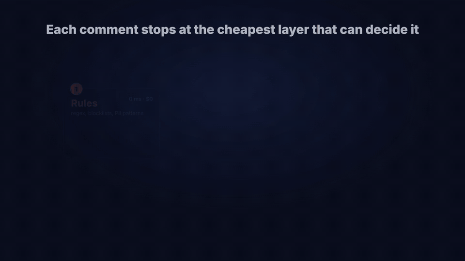
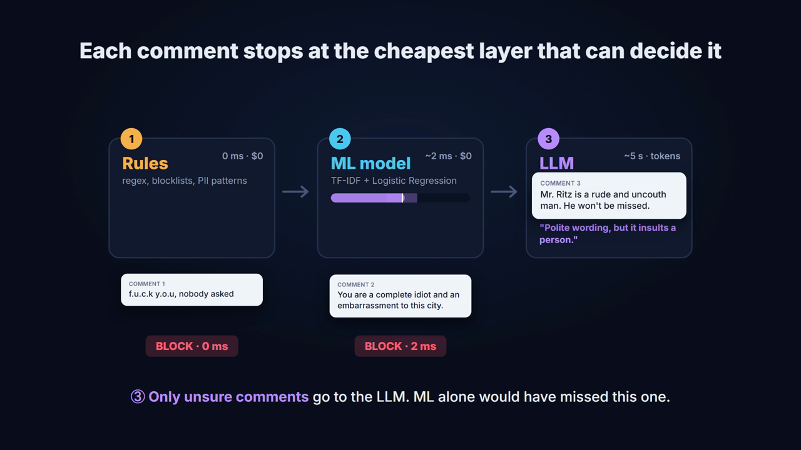
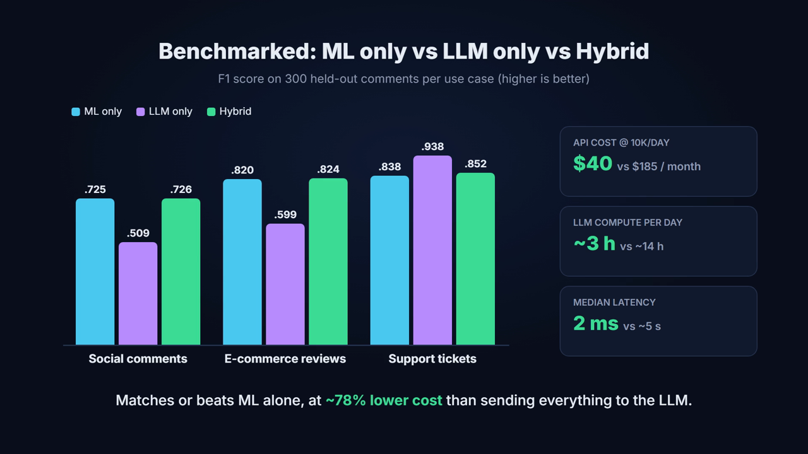
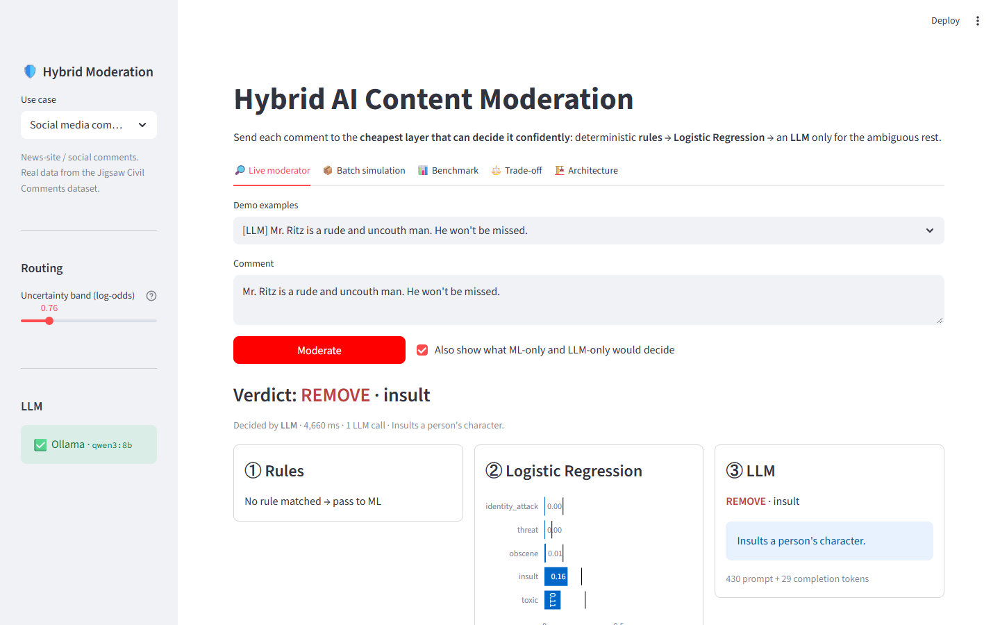
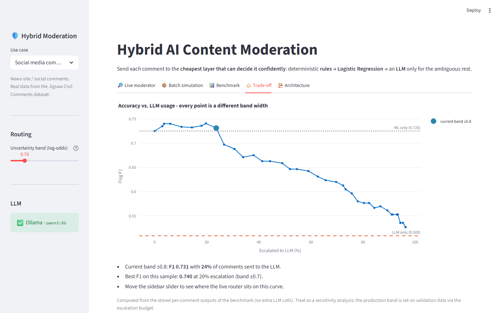
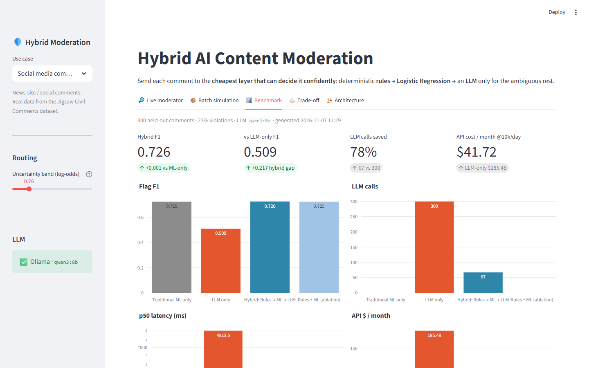

<div align="center">

# 🛡️ Hybrid AI Content Moderation

**Rules → Machine Learning → LLM, used only when it's needed.**

Moderating 10,000 comments a day by sending every one to an LLM is slow and expensive.
This system sends each comment to the **cheapest layer that can decide it confidently**,
and benchmarks that design against ML only and LLM only.




🎬 **[Watch the 1:45 narrated explainer](demo/explainer/how_it_works_voiced.mp4)**

</div>

---

## Highlights

| | Hybrid | vs LLM only |
|---|---|---|
| **F1 score** | matches or beats ML alone on all 3 use cases | LLM-only is *worse* on 2 of 3 |
| **Cost** (hosted API, 10k comments/day) | **~$40 / month** | $185 / month (**~78% saved**) |
| **Median latency** | **2 ms** | ~5 s |
| **LLM compute** on local hardware | **~3 h / day** | ~14 h / day |

- **3 layers, one interface.** Every decision records *which layer decided, why, how long it took, and what it cost*.
- **3 use cases from config alone:** social comments, e-commerce reviews, support tickets.
- **Honest benchmark:** ML only vs LLM only vs Hybrid (+ a Rules+ML ablation), on held-out data, with precision, recall, FP/FN, p50/p95 latency and cost.
- **Interactive demo app** that shows a comment travelling through the layers.

## How it works

```
comment ─► ① Rules ──────────── clear-cut ──────────────► decision   (~0 ms, $0)
              │ no match
              ▼
           ② TF-IDF + Logistic Regression ── confident ──► decision   (~1–3 ms, $0)
              │ unsure band (or severity floor)
              ▼
           ③ LLM (local Ollama, JSON output + reason) ─────► decision   (seconds, tokens)
```

1. **Rules** catch the clear-cut cases instantly: blocklists with leetspeak/dot normalisation, threat patterns, spam links, phone numbers, PII (email, card, IBAN).
2. **Logistic Regression** (word + character n-gram TF-IDF, one-vs-rest) scores every label. If every score is far from its tuned threshold, it decides.
3. **The LLM** only sees comments whose scores sit in the *uncertainty band* around a threshold. It returns labels **plus a human-readable reason**. If it fails, the system falls back to the ML decision.

<p align="center"></p>

## Use cases

| Use case | Data | Labels |
|---|---|---|
| Social media comments | Real: Jigsaw Civil Comments (`google/civil_comments`) | toxic, insult, obscene, threat, identity_attack |
| E-commerce reviews | Real human vs computer-generated reviews (`theArijitDas/Fake-Reviews-Dataset`) + synthetic spam/abuse/off-topic | fake, spam, abusive, off_topic |
| Support tickets & forum | Synthetic, with hard negatives ("this bug is killing me") | pii_leak, scam, self_harm, harassment |

## Results

300 held-out comments per use case, local `qwen3:8b` via Ollama, escalation budget 20%.

<p align="center"></p>

| Use case | ML only F1 | LLM only F1 | **Hybrid F1** | Hybrid LLM calls | Median latency (Hybrid / LLM only) | API $/month @10k/day (Hybrid / LLM only) |
|---|---|---|---|---|---|---|
| Social comments | 0.725 | 0.509 | **0.726** | 22% | 2 ms / 4.8 s | $41.72 / $185.48 |
| E-commerce reviews | 0.820 | 0.599 | **0.824** | 20% | 2 ms / 4.6 s | $40.20 / $195.52 |
| Support tickets | 0.838 | 0.938 | **0.852** | 21% | 2 ms / 5.0 s | $37.59 / $179.42 |

<details><summary>Full table (precision, recall, FP/FN, p95, compute)</summary>

| Use case | Pipeline | F1 | Precision | Recall | FP | FN | LLM calls | p50 latency | p95 latency | LLM calls/day @10k | API $/month | LLM compute h/day |
|---|---|---|---|---|---|---|---|---|---|---|---|---|
| Social | ML only | 0.725 | 0.683 | 0.771 | 25 | 16 | 0 | 2 ms | 4 ms | 0 | $0.00 | 0.0 |
| Social | LLM only | 0.509 | 0.442 | 0.600 | 53 | 28 | 300 | 4,814 ms | 5,696 ms | 10,000 | $185.48 | 13.68 |
| Social | Rules + ML | 0.725 | 0.683 | 0.771 | 25 | 16 | 0 | 2 ms | 3 ms | 0 | $0.00 | 0.0 |
| Social | **Hybrid** | 0.726 | 0.655 | 0.814 | 30 | 13 | 67 | 2 ms | 5,271 ms | 2,233 | $41.72 | 3.09 |
| E-commerce | ML only | 0.820 | 0.813 | 0.827 | 34 | 31 | 0 | 1 ms | 2 ms | 0 | $0.00 | 0.0 |
| E-commerce | LLM only | 0.599 | 0.847 | 0.464 | 15 | 96 | 300 | 4,614 ms | 5,246 ms | 10,000 | $195.52 | 12.96 |
| E-commerce | Rules + ML | 0.820 | 0.813 | 0.827 | 34 | 31 | 0 | 2 ms | 4 ms | 0 | $0.00 | 0.0 |
| E-commerce | **Hybrid** | 0.824 | 0.826 | 0.821 | 31 | 32 | 61 | 2 ms | 4,802 ms | 2,033 | $40.20 | 2.66 |
| Support | ML only | 0.838 | 0.832 | 0.844 | 23 | 21 | 0 | 2 ms | 2 ms | 0 | $0.00 | 0.0 |
| Support | LLM only | 0.938 | 0.882 | 1.000 | 18 | 0 | 300 | 4,968 ms | 5,656 ms | 10,000 | $179.42 | 13.85 |
| Support | Rules + ML | 0.838 | 0.832 | 0.844 | 23 | 21 | 0 | 2 ms | 2 ms | 0 | $0.00 | 0.0 |
| Support | **Hybrid** | 0.852 | 0.831 | 0.874 | 24 | 17 | 63 | 2 ms | 5,063 ms | 2,100 | $37.59 | 2.82 |

</details>

**What the numbers say**

- **The hybrid never does worse than ML, costs ~78% less than LLM-only, and keeps median latency at
  ~2 ms.** Only escalated comments pay the ~5 s LLM latency, which shows up in the p95.
- **LLM-only is not automatically the most accurate.** On real crowd-labelled data (social) and on
  machine-generated-review detection (e-commerce), a zero-shot 8B model loses clearly to a
  Logistic Regression trained on the labels. It over-flags opinions (social) and cannot spot
  generated reviews (e-commerce, 96 misses).
- **Where semantics matter, the LLM wins.** On support tickets (unseen phrasings of scams and
  self-harm) LLM-only reaches 0.938 with zero misses. The trade-off curve shows the hybrid gets
  most of that by spending more: at ~34% escalation F1 rises to **0.898** and misses fall 21 → 7.
- **The right budget is per use case.** In the trade-off sweep, social peaks at ~14% escalation
  (0.732, and more LLM makes it *worse*). E-commerce peaks at ~32% (0.848, where the LLM mostly
  removes false positives). Support keeps improving up to ~80%. One config value
  (`routing.escalation_budget`) sets this per use case.
- **LLM-only doesn't fit on local hardware.** 10k comments/day × ~5 s ≈ 13–14 hours of LLM compute
  per day on this machine, vs ~3 hours for the hybrid.

*API cost* = tokens counted by Ollama × an example hosted rate (`config/costing.yaml`; edit it to
your provider's prices). *LLM compute h/day* = measured LLM time per comment × 10,000 comments on
this machine.

## Demo app

`streamlit run app/streamlit_app.py` opens five tabs: **Live moderator**, **Batch simulation**, **Benchmark**, **Trade-off** and **Architecture**.

| Live moderator: see which layer decided and why | Trade-off: accuracy vs. share of traffic sent to the LLM |
|---|---|
|  |  |

<details><summary>Benchmark tab</summary>



</details>

## Engineering decisions worth discussing

- **Uncertainty band in log-odds around each label's tuned threshold.** A fixed probability band
  (e.g. 0.2–0.8) broke on the support domain. Its tuned thresholds were ~0.05, so the "confidently
  clean" zone silently threw away violations that ML alone would have caught (hybrid F1 fell to 0.43
  in a smoke test). Measuring distance from the threshold fixes that for any calibration.
- **Escalation budget → band width.** You choose "send ~20% of ML traffic to the LLM", and training
  turns that into the band width on validation data. One knob trades accuracy against spend (see
  the Trade-off tab).
- **Severity-aware routing.** ML was *confidently wrong* on an indirect self-harm post
  ("I don't think I'll be around much longer", p=0.04). For high-risk labels, any probability above a
  small floor gets an LLM second opinion.
- **Honest evaluation of synthetic data.** Template-generated data first gave a perfect 1.0 F1
  because the model had memorized the templates. Val/test now hold out whole templates, so they
  measure generalization to unseen phrasing.
- **Graceful degradation.** If Ollama is down or returns invalid JSON (after one retry), the hybrid
  falls back to the ML decision and records the error.
- **Caching.** LLM answers are cached on disk with their original latency and token counts, so reruns
  are free but still report real costs. The cache from the published benchmark is included in
  `cache/`, so `scripts/benchmark.py --sample 300` reproduces the table without re-running the LLM.

## Quick start

Prerequisites: Python 3.11+ and [Ollama](https://ollama.com) with a local model
(`ollama pull qwen3:8b`, or set `MODERATION_LLM_MODEL`). Without Ollama, the app and pipeline still
run and fall back to the ML decision.

```bash
git clone <this-repo-url> && cd <repo-folder>
pip install -r requirements.txt

python scripts/prepare_data.py            # downloads public datasets, builds splits for all 3 use cases
python scripts/train.py                   # trains Logistic Regression + calibrates the uncertainty band
python scripts/benchmark.py --sample 300  # ML only vs LLM only vs Hybrid (+ Rules+ML ablation)
python scripts/report.py                  # markdown results table
streamlit run app/streamlit_app.py        # demo app
pytest                                    # 32 unit tests
```

## Project layout

```
config/domains/*.yaml   labels, rules, routing budget, LLM policy + few-shots, demo examples
config/costing.yaml     price assumptions
moderation/             rules · ml_model · llm · pipeline · metrics · costing · schema
scripts/                prepare_data · train · benchmark · report · try_examples · make_readme_assets
app/streamlit_app.py    Live moderator · Batch simulation · Benchmark · Trade-off · Architecture
results/                benchmark output (JSON summary + per-comment parquet) per use case
tests/                  rules, routing, LLM JSON parsing/fallback, metrics
demo/explainer/         motion-graphics explainer (GSAP) + AI voiceover pipeline
docs/                   README images
```

Adding a use case = one YAML file + a data builder in `scripts/prepare_data.py`.

## The explainer video

The video in [`demo/explainer/`](demo/explainer) is generated from code, not edited by hand:

- `explainer.html` is a GSAP animation driven by one timeline.
- `render.py` steps through it frame by frame in headless Chrome (Playwright) and encodes the frames to MP4 with ffmpeg.
- `voiceover.py` creates the narration with a neural text-to-speech voice (edge-tts). Where a spoken line runs longer than its scene, it inserts a pause into the animation, so the voice and visuals stay in sync. It then re-renders the video and mixes in the audio.

```bash
pip install playwright edge-tts imageio-ffmpeg
python demo/explainer/voiceover.py        # -> demo/explainer/how_it_works_voiced.mp4
```

## Limitations

- The benchmark uses a 300-comment sample per use case because LLM-only runs at ~5 s/comment locally.
- The social sample is enriched to ~25% toxic (the natural rate is ~8%). Support data is synthetic.
- The trade-off curve is computed on the evaluation sample and is a sensitivity analysis, not a
  tuning step. The production band comes from validation data.

## License

[MIT](LICENSE)
